# Reinforcement Learning for Maze Navigation

A Q-learning agent that learns to navigate grid mazes purely by trial and error, with no map and no pre-programmed solution. The project covers a **fixed maze** (Part I) and **randomly generated mazes** (Part II), including a test on mazes the agent has never seen.

Built with Python, NumPy and Matplotlib only. No RL library and no dataset are used.

---

## Table of Contents
- [Problem Definition](#problem-definition)
- [Algorithm](#algorithm)
- [Project Structure](#project-structure)
- [Setup and Usage](#setup-and-usage)
- [Part I: Fixed Maze](#part-i-fixed-maze)
- [Part II: Random Mazes](#part-ii-random-mazes)
- [Limitations](#limitations)

---

## Problem Definition

| Component | Definition |
|---|---|
| **Agent** | A robot that moves through the maze |
| **Environment** | 10×10 grid with walls, trap cells, a start cell (top-left) and a goal cell (bottom-right). An episode ends at the goal, in a trap, or after 200 steps |
| **State** | Part I / Exp. A: position `(row, col)`. Exp. B: local observation (4 neighbouring cells, goal direction, visited flags) |
| **Actions** | Up, Right, Down, Left |
| **Rewards** | +100 goal, −50 trap, −5 wall/boundary bump, −1 every other step |
| **Objective** | Maximise cumulative discounted reward: reach the goal by the shortest safe path |

<p align="center">
  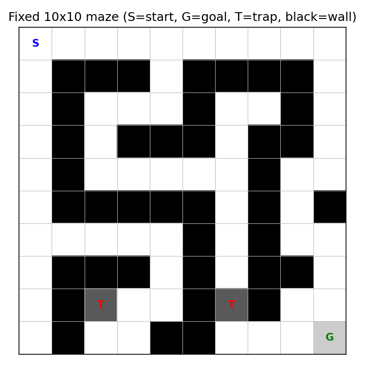<br>
  <em>Figure 1: The fixed 10×10 maze (S = start, G = goal, T = trap, black = wall).</em>
</p>

## Algorithm

**Tabular Q-learning** (model-free, off-policy temporal-difference learning) with epsilon-greedy exploration:

```
Q(s, a) ← Q(s, a) + α [ r + γ · max Q(s′, a′) − Q(s, a) ]
```

Q-learning was chosen because the state and action spaces are small and discrete, the agent needs no model of the maze, and the learned Q-table can be inspected directly. **SARSA** (on-policy) is trained alongside it for comparison.

| Parameter | Part I | Exp. A | Exp. B |
|---|---|---|---|
| Learning rate α | 0.1 | 0.1 | 0.03 |
| Discount γ | 0.97 | 0.97 | 0.97 |
| ε start → end | 1.0 → 0.02 | 1.0 → 0.02 | 1.0 → 0.05 |
| Training | 1,500 episodes | 2,000 episodes per maze | 40,000 mazes |

## Project Structure

```
maze-rl-repo/
├── maze_rl.py             # Part I: fixed maze, Q-learning + SARSA
├── maze_rl_random.py      # Part II: random mazes, Experiments A and B
├── images/                # Figures used in this README
├── environment.yml        # Conda environment
├── requirements.txt       # pip requirements
└── README.md
```

When you run the scripts they also write their own plots to `plots/` and `plots_random/`.

## Setup and Usage

```bash
# 1. Create the environment
conda env create -f environment.yml
conda activate rl
#    or: pip install -r requirements.txt

# 2. Part I: fixed maze (a few seconds)
python maze_rl.py

# 3. Part II: random mazes (about 1.5 minutes)
python maze_rl_random.py
```

Useful options:

```bash
python maze_rl.py --episodes 3000 --seed 1 --animate     # watch the final path in the terminal
python maze_rl_random.py --only A                        # only Experiment A
python maze_rl_random.py --only B --train-mazes 40000    # only Experiment B
python maze_rl_random.py --no-plots                      # skip image generation
```

---

## Part I: Fixed Maze

The agent starts with an all-zero Q-table. Early episodes are close to random walks that often time out; as Q-values are updated the agent reaches the goal more often and in fewer steps.

<p align="center">
  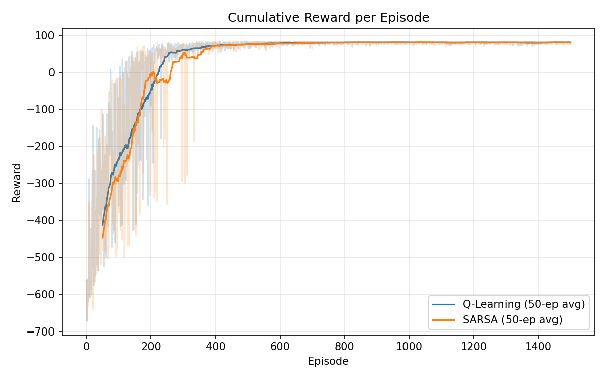<br>
  <em>Figure 2: Cumulative reward per episode. Reward rises from about −420 to a plateau near +80.</em>
</p>

<p align="center">
  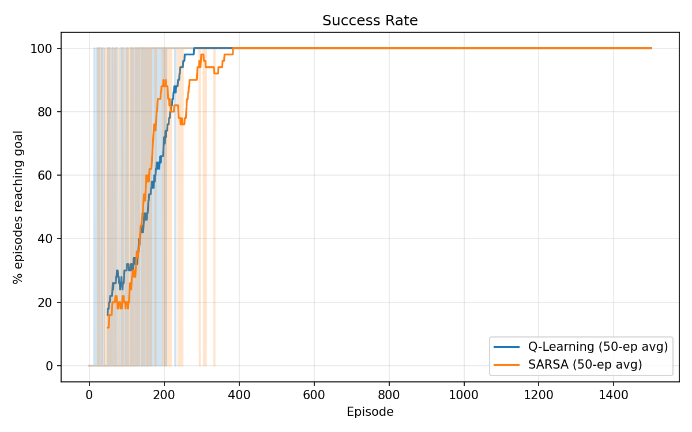<br>
  <em>Figure 3: Success rate during training. Q-learning reaches 100% by about episode 280, SARSA by about episode 380.</em>
</p>

<p align="center">
  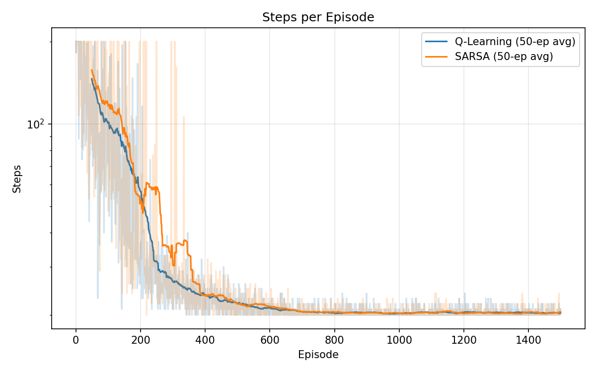<br>
  <em>Figure 4: Steps per episode (log scale). Average length falls from about 150 steps to about 20, the shortest path.</em>
</p>

<p align="center">
  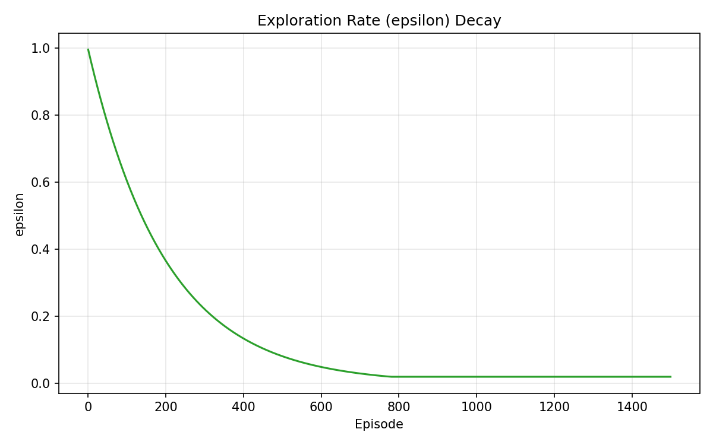<br>
  <em>Figure 5: Exploration rate decay. The agent shifts from exploring to exploiting.</em>
</p>

<p align="center">
  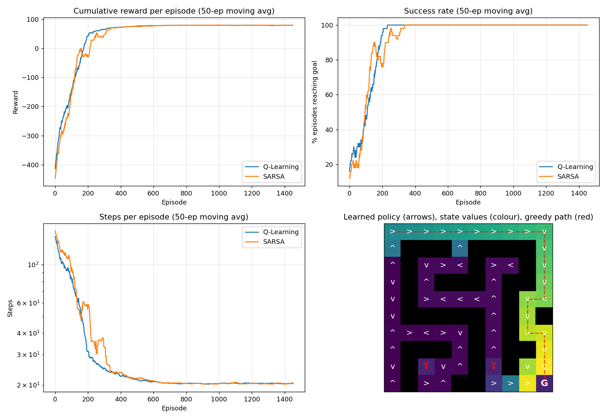<br>
  <em>Figure 6: Summary of learning curves and the learned policy. Arrows show the greedy action, colour shows state value, the dashed red line is the greedy path.</em>
</p>

### Evaluation (100 greedy episodes)

| Agent | Success rate | Avg. reward | Avg. steps |
|---|---|---|---|
| Random policy (baseline) | 2% | −560.1 | 187 |
| Q-learning | **100%** | **81.0** | **20.0** |
| SARSA | **100%** | **81.0** | **20.0** |

The trained agent always reaches the goal with the shortest path, which gives the maximum possible return of 81.

---

## Part II: Random Mazes

Every maze has 30% random walls and 4% random traps. A breadth-first search (BFS) guarantees each maze is solvable by a trap-free path, and gives the optimal path length used as a reference.

<p align="center">
  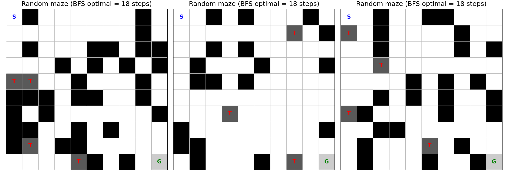<br>
  <em>Figure 7: Examples of randomly generated mazes with their BFS optimal path lengths.</em>
</p>

### Experiment A: a fresh agent learns each random maze

For each of 20 random mazes a new Q-learning agent (state = position) is trained for 2,000 episodes.

<p align="center">
  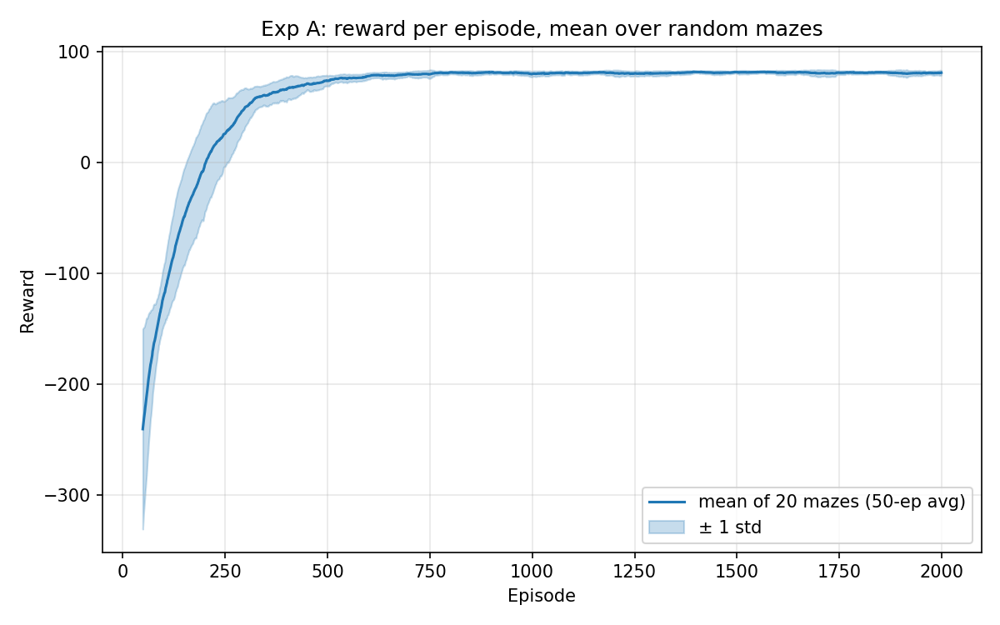<br>
  <em>Figure 8: Reward per episode averaged over 20 random mazes (shaded band = ±1 std).</em>
</p>

<p align="center">
  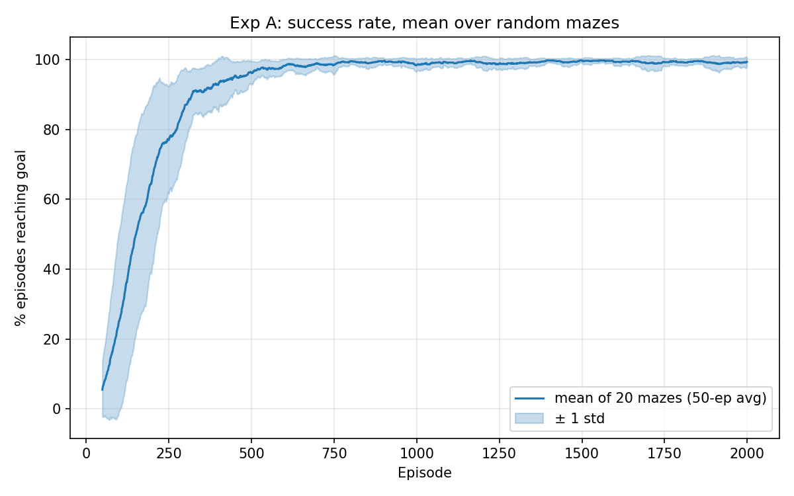<br>
  <em>Figure 9: Success rate averaged over 20 random mazes.</em>
</p>

<p align="center">
  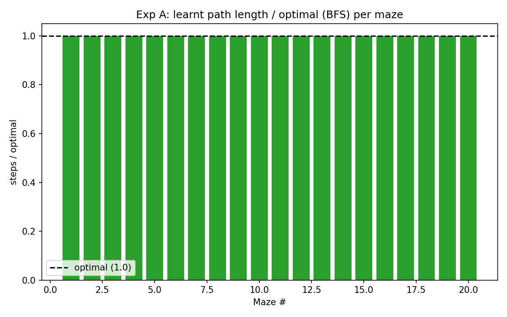<br>
  <em>Figure 10: Learnt path length relative to the BFS optimum (1.0 = shortest possible).</em>
</p>

| Measure | Result |
|---|---|
| Mazes solved | **20 / 20** |
| Mean path length ÷ optimal | **1.00** |

### Experiment B: one agent that generalises to unseen mazes

A single Q-table is trained on a stream of different random mazes, then tested on 100 unseen mazes with learning switched off. The state describes the agent's surroundings instead of its coordinates, so what it learns transfers to new mazes:

- the 4 neighbouring cells (free / wall / trap)
- the direction of the goal (sign of row and column difference)
- which neighbours were already visited in this episode

This gives 3⁴ × 9 × 16 = 11,664 states.

<p align="center">
  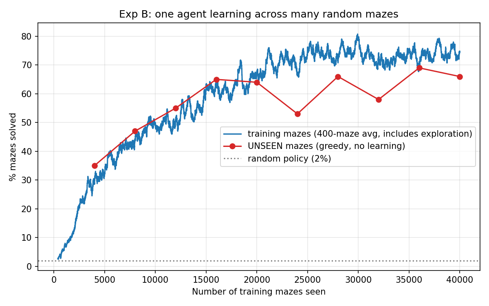<br>
  <em>Figure 11: Learning across many random mazes. Red = success on unseen mazes (greedy policy), dotted = random policy.</em>
</p>

<p align="center">
  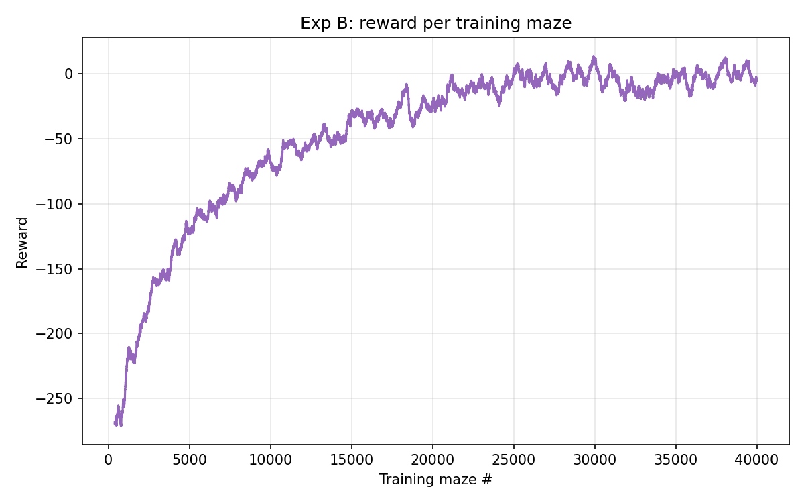<br>
  <em>Figure 12: Reward per training maze.</em>
</p>

<p align="center">
  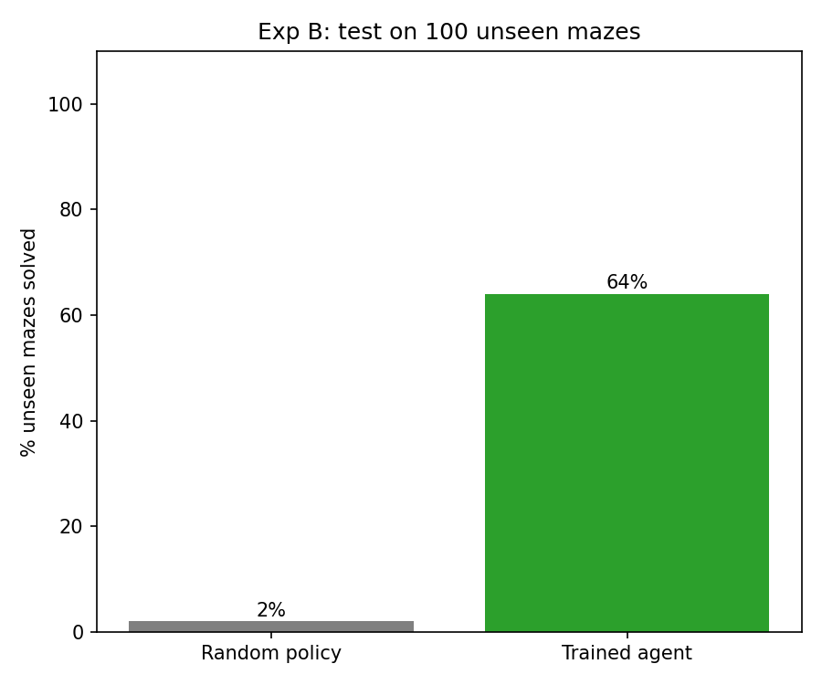<br>
  <em>Figure 13: Final test on 100 unseen mazes.</em>
</p>

<p align="center">
  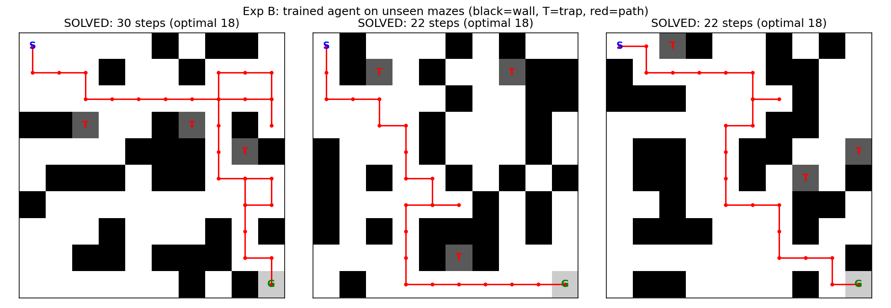<br>
  <em>Figure 14: Trained agent on three unseen mazes (black = wall, T = trap, red = path taken).</em>
</p>

| Agent | Unseen mazes solved | Avg. reward | Path ÷ optimal |
|---|---|---|---|
| Random policy | 2% | −293.9 | n/a |
| Trained agent | **64%** | −22.3 | 1.28 |

---

## Limitations

- **Generalisation is partial.** The agent solves roughly two thirds of unseen mazes. Longer training and different learning rates did not raise this above about 65–70%.
- **Partial observability.** The agent only sees its 4 neighbouring cells, so it cannot detect large dead ends.
- **Results vary between runs.** The unseen-maze success rate fluctuated between about 53% and 69% across checkpoints, because each checkpoint tests only 100 mazes. Read 64% as "roughly 65%".
- **Experiment A mazes are fairly easy.** Most have the minimum possible optimal path of 18 steps.
- **Q-learning and SARSA give the same result on the fixed maze,** because the traps are not next to the optimal path.
- **Tabular methods do not scale** to large state spaces.
